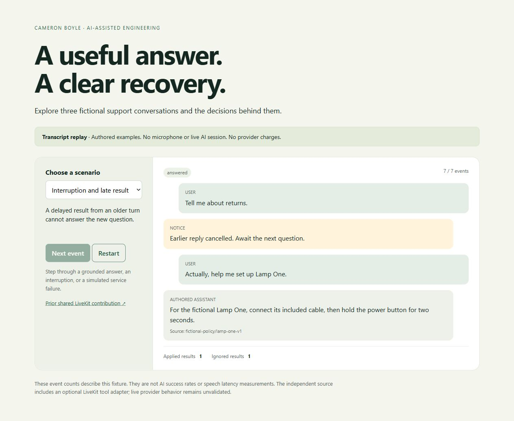

# Voice Support Workbench

A fictional support-agent engineering example by Cameron Boyle, built with AI-assisted implementation and review. Explore how a response is grounded in an approved policy, how an interrupted turn rejects a late result, and how a service failure leaves a clear next step.

**Current demonstration:** an interactive transcript replay with authored fictional conversations. The replay has no microphone, model, speech recognition, synthesized speech or LiveKit room connection. It demonstrates application contracts, not live speech or model quality.



[Try the public transcript replay](https://cameronjohnboyle2-hub.github.io/voice-support-workbench/) · [Verified source checks](https://github.com/cameronjohnboyle2-hub/voice-support-workbench/actions/runs/38301072152) · [Architecture](docs/ARCHITECTURE.md)

## Try it locally

With Python 3.10+ and Node.js 22+:

```sh
python -m unittest discover -s tests -p "test_*.py"
node --test tests/replay.test.mjs
python -m http.server 4190 --bind 127.0.0.1 --directory site
```

Open http://127.0.0.1:4190. Choose a scenario and step through its events. Only `site/` belongs in a hosted artifact. No installation is required for the replay or domain tests.

## What it demonstrates

- A read-only support tool returns a policy with a source reference and an explicit handoff when the question is outside its scope.
- Turn identities keep delayed tool results from becoming answers to a newer question. Interruption changes the active turn before the older result arrives.
- Tool identifiers prevent a duplicated delivery from being applied twice. A failed lookup creates a visible failure state without silently retrying paid services.
- Tool output is treated as data. It does not change the assistant's instructions or authorize external actions.
- The browser displays authored transcripts through text nodes, keeps state in memory, and blocks network connections and form submission.

The fictional shop is **Maple Desk**. All policies, product names and dialogue are invented; there are no orders, customers, contact details, employer code or research settings.

## LiveKit integration boundary

`support/agent.py` registers the fictional policy function as a LiveKit Agents Python tool. The optional [controlled launcher](support/live.py) connects that agent to a speech/model/synthesis pipeline and limits a job to two minutes. Six offline SDK checks cover tool registration, policy output, real pipeline construction, missing configuration, deadline shutdown and failed-start cleanup. The launcher's live room/tool integration remains untested.

A separate prompt-grounded prototype was deployed through LiveKit Agent Builder. On October 12, a consented manual test produced the expected return-window, Lamp One setup and refund-refusal replies, and the owner confirmed the spoken interaction worked. Optional observability and recording were off; the session ended after 1 minute 48 seconds. This Builder prototype embeds the invented policies in its prompt and does not use the code-owned tool. No caller audio is distributed. See [voice setup and evidence boundaries](docs/VOICE_SETUP.md).

```sh
python -m venv .venv
.venv\Scripts\python -m pip install -r requirements-sdk.txt
.venv\Scripts\python -m unittest discover -s tests -p "sdk_*.py"
```

On macOS/Linux use `.venv/bin/python` for the final two commands. The pinned environment was resolved on Python 3.12; other Python/platform combinations need their own compatible-wheel check.

Acoustic interruption, prompt-injection resistance, provider recovery and representative latency still require their own acceptance. The three manual Builder replies support only those three checked scenarios. See [architecture](docs/ARCHITECTURE.md) and [evaluation plan](docs/EVALUATION.md).

## Contribution and rights

Cameron's verified prior LiveKit interview contribution is in the shared [Career Compass PR #9](https://github.com/nola4211/byu-is-career-compass/pull/9). This workbench is a new independent fictional implementation prepared for the portfolio; it is not a migrated research experiment or a claim of customer adoption. It separates code-owned support policies from model phrasing and makes unvalidated provider behavior explicit.

Original workbench code is presented for review with rights retained; no general reuse license is granted. The optional LiveKit package is separately licensed Apache-2.0; its dependencies retain their own licenses and are not bundled into the static demo. No third-party fonts, images, models or audio are distributed.

## Current limits

The replay uses simulated event order and authored response text. Its counts are fixture checks, not task-success rates, measured model latency or cost savings. The optional launcher has provider configuration but supplies no public token endpoint, persistent logs, order mutation or actual human handoff. Its SDK may prewarm a connection when a configured pipeline is constructed; the offline construction test suppresses that HTTP prewarming.

The opt-in [voice page](site/voice.html) unloads its widget on consent withdrawal, End demo, page exit or a two-minute browser timer. Three automated checks cover its consent and cleanup behavior. The third-party widget bundle is integrity-pinned to the reviewed version. The managed widget must be separately enabled for the portfolio origin; its public operation remains unverified until that account setting and hosted acceptance are complete. The browser timer is not a server usage or concurrency limit. The code-owned launcher's live integration also needs a separate test. Use existing free quota where available; no paid upgrade is required.
